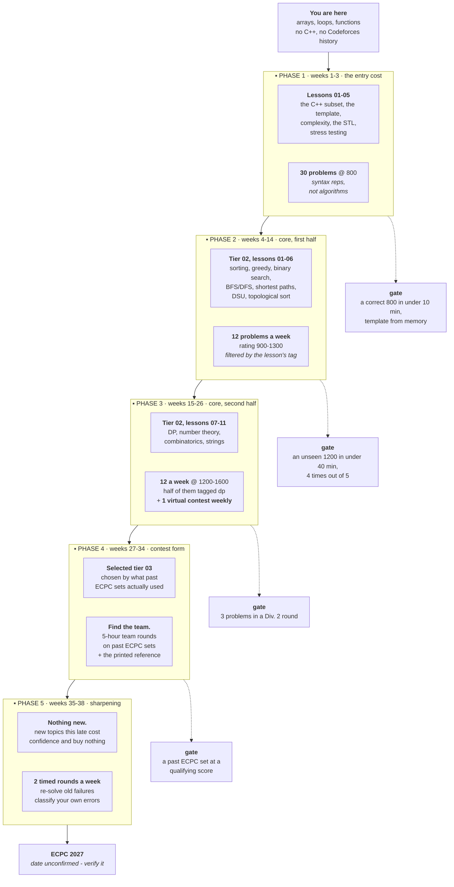
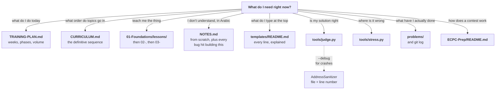
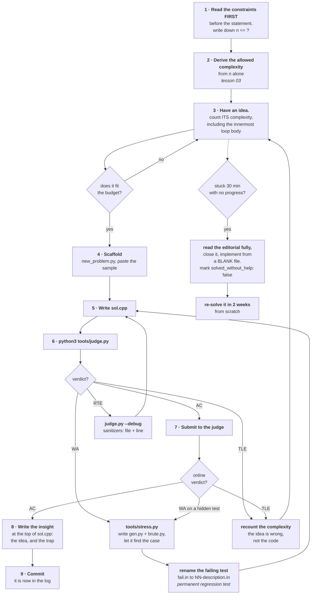
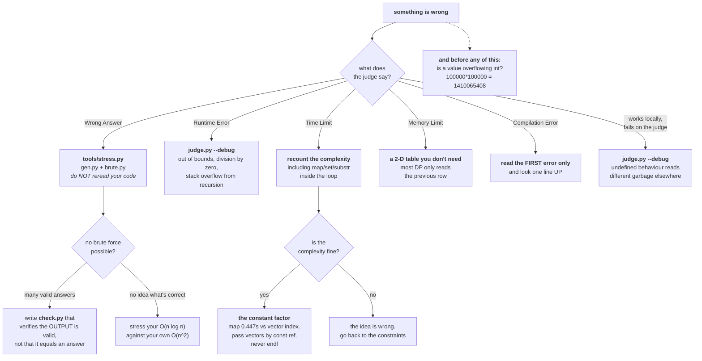
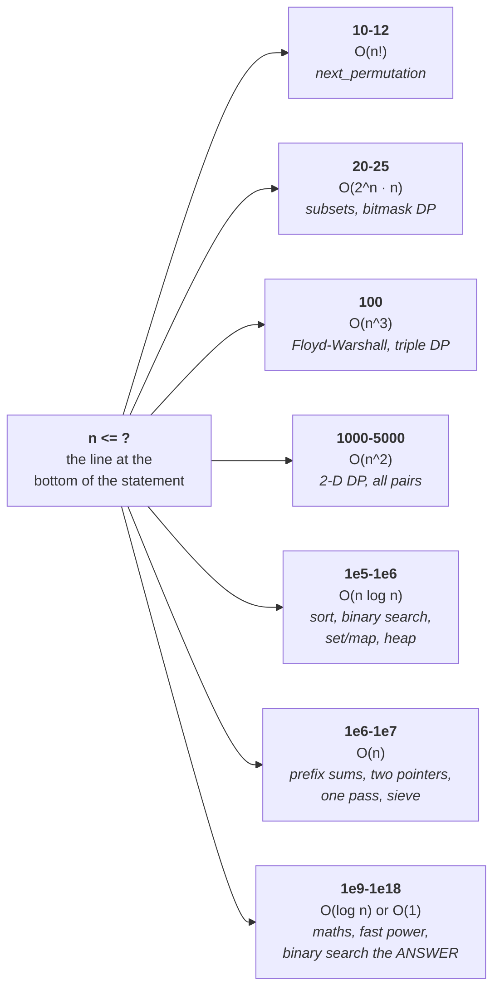
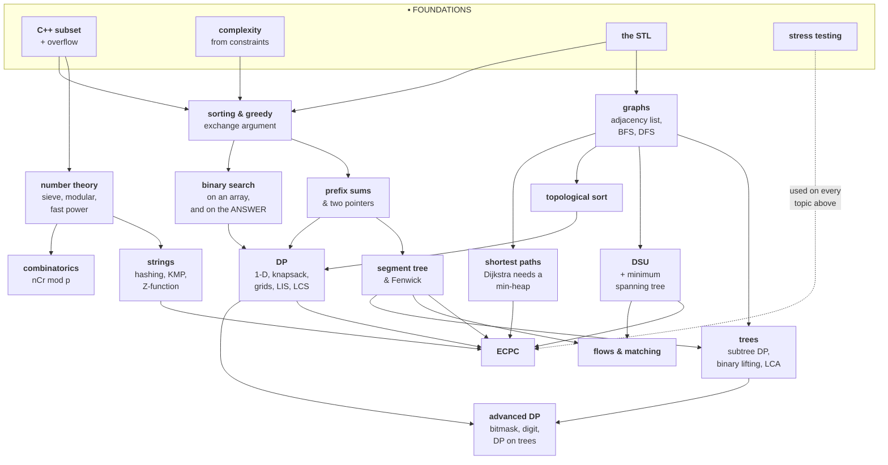
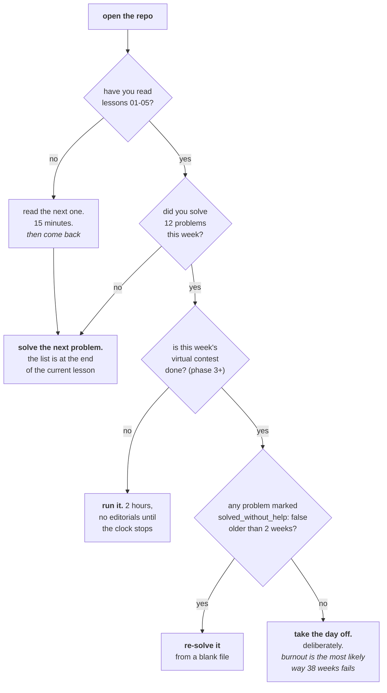

# The map

One page. Read it when you start, and again whenever you are not sure what to
do next. Everything else in this repository is reachable from here.

If you only read one section, read **§3 · The loop** below. That loop is the
training; everything else exists to make it fast.

---

## 1 · The whole road

The gates matter more than the weeks. **A phase is finished when its gate
opens, not when its weeks run out.** If week 14 arrives and an unseen 1200
still takes you ninety minutes, you are in phase 2 — carry on, and move the
later dates. Marching forward on schedule with a gate unmet is how people
arrive at a contest having read about everything and being fast at nothing.

Full detail: [`TRAINING-PLAN.md`](TRAINING-PLAN.md). Topic order:
[`CURRICULUM.md`](CURRICULUM.md).

---

## 2 · The repo, by the question it answers

`problems/` is the only directory that grows every day. The lessons are
scaffolding; **the problem log is the artifact.**

---

## 3 · The loop: one problem, start to finish

This is the repository. Everything else exists to make this loop fast.

Three things in that diagram are easy to skip and are the whole point:

**Steps 1–3 happen before you touch the keyboard.** They take a minute.
Typing the wrong idea takes twenty, and then you throw it away while the clock
runs.

**A WA never sends you back to reading your own code.** It sends you to
`stress.py`. Five minutes of mechanical work beats an hour of staring, every
time — see [lesson 05](01-Foundations/lessons/05-stress-testing.md), where the
tool found a one-element failing test on its second try.

**Step 8 is not paperwork.** One or two sentences at the top of `sol.cpp`
saying the idea and the trap. Re-reading your own summaries from three months
ago is the cheapest revision that exists.

---

## 4 · When it goes wrong: symptom to tool

The overflow box is dotted because it is not a verdict — it is the thing to
suspect regardless of which verdict you got. It produces wrong answers,
impossible timings and bizarre crashes, and it is invisible if you came from
Python. [Lesson 01 §2](01-Foundations/lessons/01-cpp-for-python-programmers.md).

---

## 5 · The constraint tells you the algorithm

Read this before the statement. It is the most valuable twenty seconds in any
contest problem.

`n <= 20` is a billboard reading "iterate over subsets". Nobody writes
`n <= 20` by accident. And `n <= 2e5` — the most common bound on Codeforces —
means O(n log n): if your idea is O(n²), it is the wrong idea, and you should
not start typing.

Watch for **"the sum of n over all test cases"**. That is a different, looser
promise than a per-case bound, and mistaking it makes you discard a correct
solution.

---

## 6 · What depends on what

Nothing here is optional, but the arrows are real: a topic with an unmet
prerequisite will not stick.

Two readings of that graph are worth making explicit.

**DP has three arrows into it.** Prefix sums, binary search and topological
sort all feed it, which is why DP is where people stall: arriving there with a
shaky grasp of any of the three makes DP feel like magic rather than like
bookkeeping. If phase 3 is going badly, the fix is usually in phase 2.

**`stress testing` has a dotted arrow to the end.** It is not a topic you
finish. It is the tool you use on every topic, for thirty-eight weeks.

---

## 7 · Today

When you do not know what to do, do this:

That last box is not filler. Over thirty-eight weeks, burnout is a more likely
cause of failure than any topic being too hard.

---

## The two rules, once more

**Nothing enters `problems/` until `tools/judge.py` prints AC.** Not "I think
this is right". The machine compiled it and ran it. CI re-checks every solution
on every push.

**Every failing case the stress tester finds becomes a permanent test file.**
It is the one bug you are guaranteed never to make twice, and it makes the test
suite a record of your own mistakes — the only test suite that is actually
about you.
